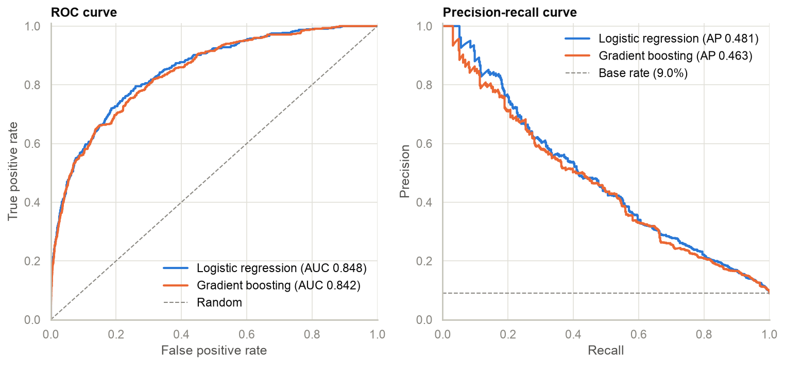
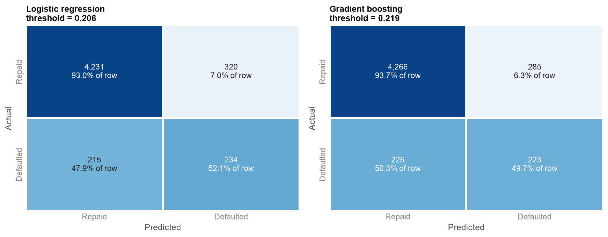
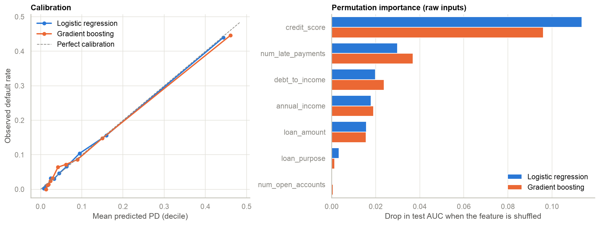

# Credit Risk Model

A probability-of-default (PD) model for consumer loan applications, built with **scikit-learn**. The
project goes from exploratory analysis and feature engineering, through statistical validation of the
features, to a logistic regression and a gradient boosting classifier evaluated on a held-out test set.

- **`analysis.ipynb`**: the full analysis with outputs: EDA, feature engineering, statistical tests,
  modelling and evaluation.
- **`src/pipeline.py`**: the same training pipeline as a command-line script.

## Results

Held-out test set: 5,000 applications, 9.0% default rate.

| Metric | Logistic regression | Gradient boosting |
|---|---|---|
| 5-fold CV AUC (train) | 0.841 ± 0.010 | 0.840 ± 0.010 |
| **Test AUC-ROC** | **0.848** | 0.842 |
| Gini | 0.696 | 0.684 |
| KS statistic | 0.535 | 0.513 |
| Average precision (PR-AUC) | 0.481 | 0.463 |
| Brier score | 0.0619 | 0.0629 |
| Decision threshold (max F1 on training folds) | 0.206 | 0.219 |
| Precision / recall on defaults | 42.2% / 52.1% | 43.9% / 49.7% |





**Takeaways**

1. **The two models perform about the same.** The 0.006 AUC gap is smaller than the fold-to-fold CV spread
   (±0.010). Binning and interaction terms give logistic regression the non-linearity gradient boosting
   would otherwise have to find for itself.
2. **Logistic regression is the recommended model.** For equal accuracy it is transparent: coefficients can
   be audited, turned into scorecard points, and used to generate adverse-action reasons.
3. **Both models are well calibrated**, so predicted PDs can be used directly for pricing or expected loss.
4. **Operating point.** At its threshold, logistic regression flags 11% of applications. It catches 52% of
   defaulters, and 42% of flagged applications do default, versus 9% at random. A real cut-off should come
   from the cost of a missed default vs a declined good customer, not from F1.
5. **Risk drivers.** Credit score dominates, followed by late payments, debt-to-income, income and loan size
   relative to income. Loan purpose and number of open accounts contribute little.

## Data

`data/credit_data.csv` contains 25,000 **synthetic** loan applications generated by `src/data.py`:

| Column | Description |
|---|---|
| `credit_score` | FICO-style score, 300-850 |
| `annual_income` | Self-reported annual income in USD (about 3% missing) |
| `debt_to_income` | Monthly debt payments / monthly income, as a ratio (0.30 = 30%) |
| `num_open_accounts` | Open credit lines |
| `num_late_payments` | Late payments on the credit file |
| `loan_amount` | Requested amount in USD |
| `loan_purpose` | `debt_consolidation`, `credit_card`, `home_improvement`, `auto`, `medical`, `small_business`, `education`, `other` |
| `default_flag` | Target: 1 = defaulted |

**How the data is generated.** Each applicant has a hidden creditworthiness factor. That factor drives the
observed fields: higher scores, lower DTI and fewer late payments for better borrowers. Default is drawn from
a logistic model with deliberate non-linear effects:

- risk accelerates below a score of about 630;
- risk rises steeply once the loan exceeds about 35% of income;
- late payments hurt more at high DTI;
- thin credit files carry extra risk.

A large unobservable component caps achievable AUC at a realistic level. The intercept is calibrated to a 9%
default rate.

Synthetic data is used because the requested columns don't map onto Kaggle's *Give Me Some Credit* dataset,
which has no loan amount or loan purpose and needs a Kaggle login to download. To use real data, pass any CSV
with the eight columns above: `python src/pipeline.py --data path/to/file.csv`.

## Methodology

### 1. Exploratory data analysis
Covers target balance (9% defaults, so accuracy is not a useful metric), per-class feature distributions,
missing values, and default rates by loan purpose.

### 2. Feature engineering (`src/features.py`)
`FeatureEngineer` is a scikit-learn transformer that sits inside the model pipeline, so anything it learns
(the income median used for imputation) comes from training data only.

| Step | Features |
|---|---|
| Transforms | `log_income`, `log_loan_amount` |
| Missing values | median-imputed income + `income_missing` flag |
| Ratio | `loan_to_income` |
| Interaction terms | `dti_x_late` (DTI × late payments), `score_x_dti` (standardised score × DTI) |
| Binning | FICO-style `credit_score_band`; `dti_band`; `late_payment_band` (0 / 1 / 2-3 / 4+); `open_accounts_band` (0-2 thin file / 3-9 / 10-17 / 18+) |
| Encoding | one-hot for `loan_purpose` and every band; `StandardScaler` on numeric features |

That gives 10 numeric and 5 categorical features, which become 35 model inputs.

### 3. Statistical validation (`src/stats.py`)
- **Chi-squared tests of independence** for each categorical or binned feature vs default, with
  **Cramer's V** as the effect size. With 25k rows, p-values alone flag almost everything.
- **Point-biserial correlation** and **Mann-Whitney U** for numeric features.
- **Spearman correlation matrix** to spot collinearity between engineered features and their parents.
- **Information value / weight of evidence**, the standard univariate screen in credit scoring.

| Feature | Information value | Strength |
|---|---|---|
| credit_score | 1.41 | strong |
| dti_x_late | 1.16 | strong |
| num_late_payments | 0.93 | strong |
| debt_to_income | 0.65 | strong |
| log_income | 0.20 | medium |
| loan_to_income | 0.13 | medium |
| num_open_accounts | 0.07 | weak |
| loan_purpose | 0.03 | weak |
| log_loan_amount | 0.01 | not predictive alone |

All categorical features are significant (p < 0.05). Two features are not significant on their own:
`log_loan_amount` and the `income_missing` flag. Both are kept because L2 regularisation shrinks them and loan
amount is needed for loan-to-income. The correlation matrix shows two near-duplicate pairs:

- `dti_x_late` vs late payments, ρ = 0.98
- `score_x_dti` vs credit score, ρ = 0.96

This is one reason the logistic regression is regularised.

### 4. Models (`src/pipeline.py`)
Both models share the same `FeatureEngineer` → `ColumnTransformer` front end.

- **Logistic regression** with an L2 penalty and `C=0.5`.
- **Gradient boosting** (`GradientBoostingClassifier`): 300 trees, learning rate 0.05, depth 3, subsample
  0.8, minimum 50 samples per leaf.

The data is split 80/20, stratified, with seed 42. The test set is used exactly once.

### 5. Evaluation (`src/evaluation.py`)
- 5-fold stratified cross-validation on the training set gives the CV AUC. Its out-of-fold predictions are
  used to choose each model's **decision threshold** (maximum F1), so no test data leaks into the cut-off.
- The test set is scored with **AUC-ROC, Gini, KS, precision-recall / average precision, Brier score, a
  confusion matrix and a classification report**.
- The notebook also includes a **calibration** plot and **permutation importance** on the raw inputs.

## Usage

```bash
git clone https://github.com/Shammykr/credit-risk-model.git
cd credit-risk-model
python -m venv .venv && source .venv/bin/activate
pip install -r requirements.txt

python src/pipeline.py                 # train + evaluate on data/credit_data.csv
python src/pipeline.py --generate      # regenerate the synthetic data first
python src/pipeline.py --help          # --data, --test-size, --seed, --cv-folds, --n-samples, ...

jupyter notebook analysis.ipynb        # the full analysis
pytest                                 # tests
```

The pipeline prints CV and test metrics plus the classification reports. It writes:

- `reports/metrics.json`
- `reports/figures/*.png`
- the fitted pipelines, `models/*.joblib`

Each model file is a complete scikit-learn pipeline that takes the raw columns:

```python
import joblib, pandas as pd
model = joblib.load("models/logistic_regression.joblib")
model.predict_proba(pd.read_csv("new_applications.csv"))[:, 1]   # probability of default
```

## Project layout

```
credit-risk-model/
├── analysis.ipynb          # EDA, feature engineering, stats tests, modelling, evaluation
├── src/
│   ├── data.py             # synthetic data generator + loader
│   ├── features.py         # FeatureEngineer transformer, bins, encoder
│   ├── stats.py            # chi-squared, point-biserial/Mann-Whitney, information value
│   ├── evaluation.py       # KS, threshold selection, metrics, plots
│   ├── plotting.py         # shared figure style
│   └── pipeline.py         # CLI training pipeline
├── data/credit_data.csv
├── reports/                # metrics.json + figures from the last pipeline run
└── tests/test_pipeline.py
```

## Limitations and next steps

- The data is synthetic. On real data, validate **out of time** (train on older vintages, test on newer ones),
  not with a random split.
- Lenders only observe outcomes for approved applicants. A production model needs **reject inference**.
- Possible improvements:
  - hyperparameter search;
  - monotonic constraints for the boosted model (`HistGradientBoostingClassifier(monotonic_cst=...)`);
  - a points-based scorecard derived from the logistic regression.
